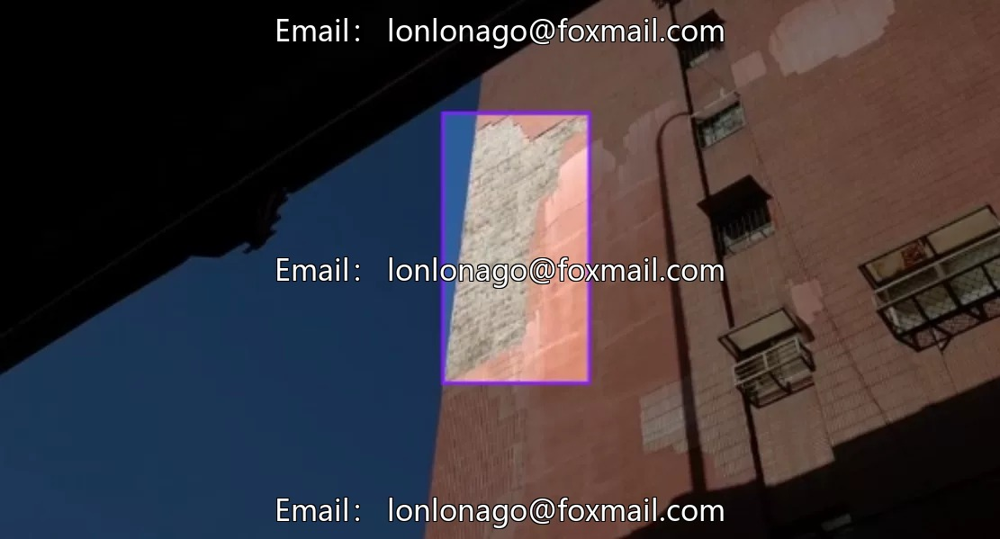
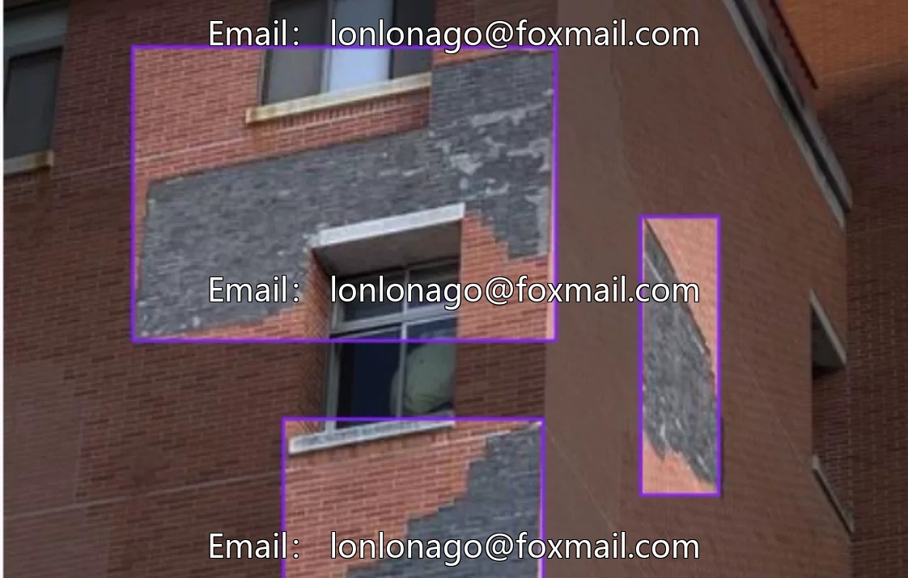
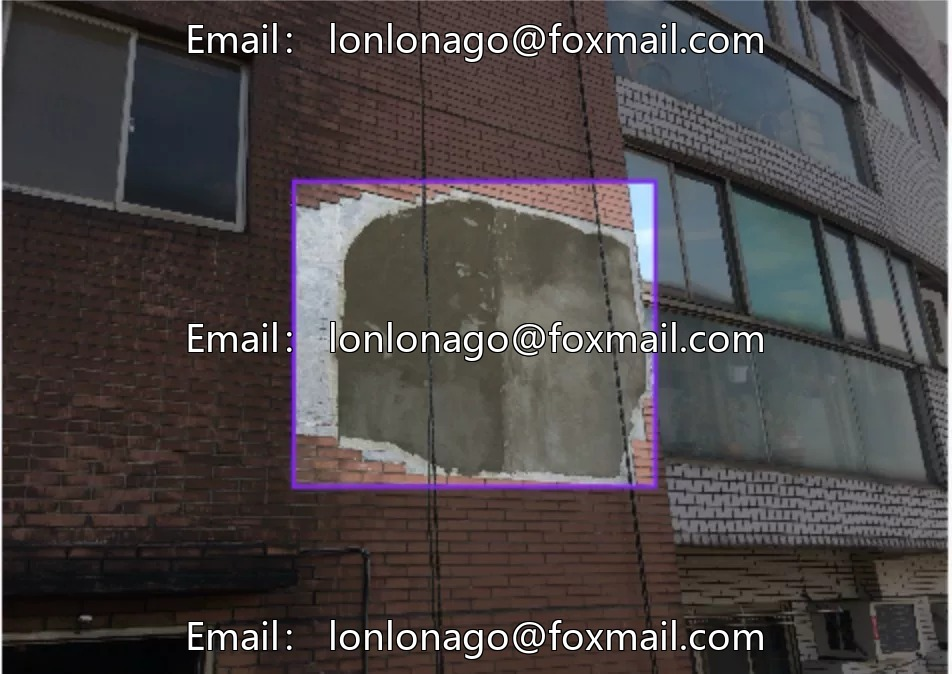
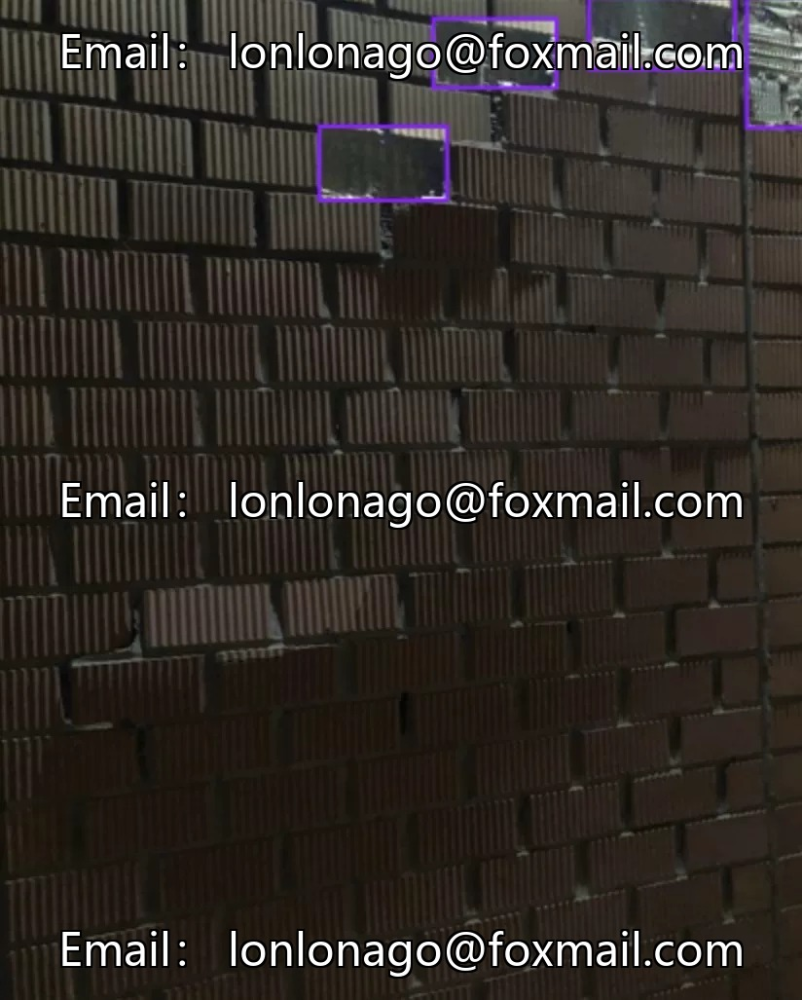
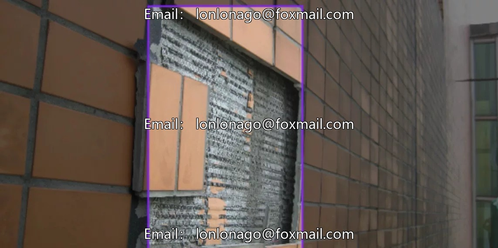

# Intelligent Recognition of Building Wall Tiles Falling Dataset, 144 images, 2 classes

## Body

Intelligent Recognition of Building Wall Tiles Falling Off Dataset, 144 images, 2 categories: crack (cracks), spit (falling off), suitable for tile surface defect detection, Computer Vision Object Detection Dataset, supports model training and testing.

The data format is an image file, with model indicator data and BibTeX citations. It can be directly used for tile defect detection, improving the efficiency of quality control.

Virtual materials, once sold, are non-refundable.
Interested friends, click "I want" to proceed.

## Images

## Payment

Here is a pay link on Stripe ( https://buy.stripe.com/3cs8yP7sY87d0vu9AB ). Please contact me lonlonago@foxmail.com after funding $89, and I will send you a complete data files , thank you!

